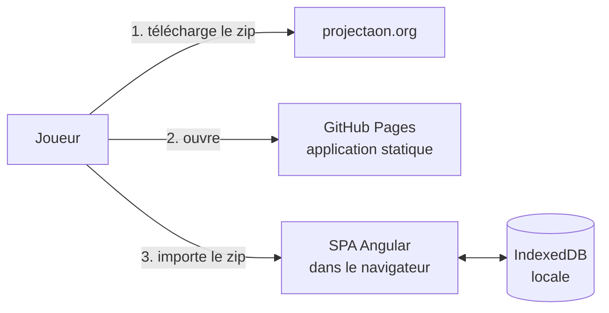

# Architecture — Lone Wolf Reader

## Vue d'ensemble

Application web statique (SPA Angular 22, PWA) pour jouer sur mobile aux livres-jeux *Loup Solitaire* publiés gratuitement par Project Aon. Il n'y a **aucun serveur applicatif** : le site est servi par GitHub Pages et tout le traitement se fait dans le navigateur du joueur.

Le contenu des livres n'est jamais hébergé par l'application ([ADR 0001](adr/0001-import-des-livres-par-le-joueur.md)). Le joueur télécharge lui-même le zip officiel sur projectaon.org, puis l'importe.

## Composants

| Composant | Responsabilité | Technologie | Dépend de |
|---|---|---|---|
| `core/book` | Décompression du zip, parsing XHTML en blocs, nettoyage HTML par liste blanche, catalogue des livres | fflate, DOMParser | — |
| `core/game` | Modèle de partie, règles (création, combat, Guérison), table des résultats de combat, tirage aléatoire | TypeScript pur | `core/book` (types) |
| `core/storage` | Schéma IndexedDB (`books`, `sections`, `pages`, `images`, `games`) | idb | — |
| `core/i18n` | Libellés FR/EN commutables à chaud | signaux Angular | — |
| `features/*` | Écrans : bibliothèque, création, lecteur et combat, Feuille d'aventure, pages du livre | composants standalone | `core/*`, `shared/*` |
| `shared/*` | Barre de titre, rendu des blocs, illustrations, Table de hasard | composants standalone | `core/*` |
| Service worker | Mise en cache de l'application pour un usage hors ligne | `@angular/service-worker` | — |

## Flux principaux

1. **Import d'un livre** : sélection du `.zip` → contrôles de taille → décompression (htm et images uniquement) → parsing de chaque page en blocs (`html`, `choice`, `combat`, `figure`, `deadend`) → enregistrement en IndexedDB (remplace un import précédent du même livre).
2. **Nouvelle partie** : tirages HABILETÉ / ENDURANCE, choix des disciplines (lues dans `discplnz.htm`), arme de Weaponskill, puis enregistrement de la partie (section 1).
3. **Lecture** : affichage de la section courante → choix → application de la Guérison sur la section quittée → enregistrement immédiat de la partie.
4. **Combat** : démarrage depuis un bloc `combat` → assauts (tirage 0-9, table des résultats) → victoire, mort ou fuite.

## Sécurité et données

- **Pas d'authentification** et pas de backend : rien ne quitte l'appareil du joueur.
- **Données traitées** : textes et illustrations des livres (sous licence Project Aon) et état de partie. Aucune donnée personnelle, de santé ni opérationnelle SDIS (voir [donnees.md](donnees.md)).
- **Contenu importé non fiable** : nettoyage par liste blanche à l'import (`html-cleaner.ts`, qui retire scripts, styles, attributs d'événement et liens hors `*.htm` / http(s)), puis assainissement Angular au rendu (`[innerHTML]`). Les illustrations sont servies en URL `blob:`.
- **Garde-fous à l'import** : zip ≤ 50 Mo, total décompressé ≤ 150 Mo, entrée ≤ 20 Mo.
- **Services tiers** : GitHub Pages (hébergement de l'application statique) et projectaon.org (lien de téléchargement suivi par le joueur, sans appel de l'application). Aucun envoi de données. L'hébergement GitHub Pages est **à valider par le Groupement SIC** si l'application devient un outil SDIS.
- **Journalisation** : aucune.

## Décisions structurantes

Voir les ADR dans [adr/](adr/).
