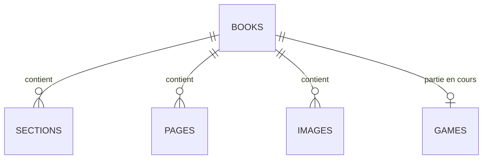

# Données — Lone Wolf Reader

Pas d'API ni de base serveur : toutes les données vivent dans l'IndexedDB `lone-wolf` du navigateur (`src/app/core/storage/database.ts`).

## Modèle de données

| Store | Clé | Contenu |
|---|---|---|
| `books` | `id` (code Project Aon, ex. `01fftd`) | Métadonnées : titre, numéro, série, langue, disciplines, pages, mention de copyright |
| `sections` | `[bookId, number]` | Blocs de la section numérotée |
| `pages` | `[bookId, id]` | Pages hors sections (règles, équipement, carte…) |
| `images` | `[bookId, name]` | Illustrations (Blob) |
| `games` | `bookId` | Partie : section, historique, personnage, combat en cours, sections avec combat |

Les stores `sections`, `pages` et `images` ont un index `byBook`, utilisé pour la suppression d'un livre.

## Procédures stockées, vues et fonctions

Sans objet (pas de base SQL).

## Classification des données

| Donnée / store | Catégorie | Sensible ? | Durée de conservation | Protection |
|---|---|---|---|---|
| `books`, `sections`, `pages`, `images` | Contenu sous licence Project Aon | non (mais redistribution interdite) | Jusqu'à suppression par le joueur | Stockage local uniquement, jamais versionné ni hébergé |
| `games` | État de jeu (caractéristiques, inventaire, notes libres) | non | Jusqu'à abandon ou suppression du livre | Stockage local uniquement |
| `localStorage['lone-wolf.lang']` | Préférence de langue | non | Indéfinie | — |

## Migrations

Schéma versionné par `DB_VERSION` dans `database.ts`. Toute évolution incrémente la version et ajoute l'étape correspondante dans `upgrade()`, sans perdre les parties existantes.
